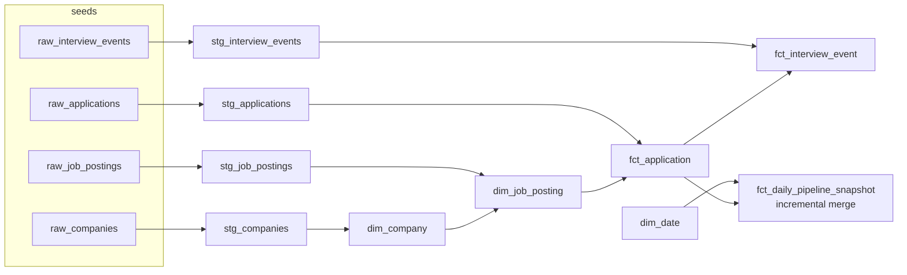

# Job Search dbt Warehouse

[](https://github.com/Deshraj-Jogiya/job-search-dbt-warehouse/actions/workflows/ci.yml) 

A dbt project that builds a dimensional model on a live Databricks SQL warehouse: staging views over seed data, then dimension and fact
tables, an incremental daily snapshot, and data tests that run against the warehouse in CI.

## Highlights

- **Dimensional model:** `dim_company`, `dim_job_posting` and `dim_date` (a 2025–2027 date spine built with `sequence()` + `explode()`),
  plus `fct_application`, `fct_interview_event` and `fct_daily_pipeline_snapshot`.
- **Measures:** a `datediff` days-to-decision measure, and a `row_number()` window function for interview-round sequencing.
- **Incremental model:** the daily snapshot uses `merge` on `date_day`, so later runs only recompute new days.
- **22 dbt tests:** 20 schema tests (6 unique, 9 not-null, 4 referential-integrity, 1 accepted-values) plus two singular
  business-rule tests (a decision date never precedes the applied date; snapshot counts never go negative).
- **Verified against the warehouse:** CI runs `dbt seed`, `dbt run` and `dbt test` on every push into a separate CI schema.

## Model



## Stack

dbt, Databricks SQL, SQL, dimensional modeling, GitHub Actions.

## Run it

Needs a Databricks SQL warehouse and a personal access token.

```bash
pip install -r requirements.txt
export DATABRICKS_HOST=<workspace-hostname>
export DATABRICKS_HTTP_PATH=<warehouse-http-path>
export DATABRICKS_TOKEN=<personal-access-token>

dbt seed --profiles-dir .
dbt run  --profiles-dir .
dbt test --profiles-dir .
```

`profiles.yml` reads all three values from the environment; no credentials are committed.

## Data

The four seed files are synthetic job-search data (companies, postings, applications, interview rounds), not a real company's data.
