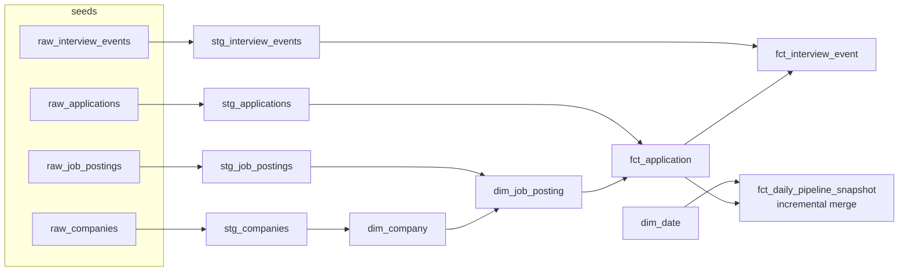

# Job Search dbt Warehouse

[](https://github.com/Deshraj-Jogiya/job-search-dbt-warehouse/actions/workflows/ci.yml) 

A dbt project that builds a dimensional model on a live Databricks SQL warehouse: staging views over seed data, then dimension and fact
tables, an incremental daily snapshot, and data tests. The same models also build on DuckDB, which is what CI runs on every push.

## Highlights

- **Dimensional model:** `dim_company`, `dim_job_posting` and `dim_date` (a 2025–2027 date spine built with `sequence()` + `explode()`),
  plus `fct_application`, `fct_interview_event` and `fct_daily_pipeline_snapshot`.
- **Measures:** a `datediff` days-to-decision measure, and a `row_number()` window function for interview-round sequencing.
- **Incremental model:** the daily snapshot uses `merge` on `date_day` (`delete+insert` on DuckDB), so later runs only recompute new days.
- **22 dbt tests:** 20 schema tests (6 unique, 9 not-null, 4 referential-integrity, 1 accepted-values) plus two singular
  business-rule tests (a decision date never precedes the applied date; snapshot counts never go negative).
- **Runs on two engines:** five small macros (`macros/portable.sql`) cover the SQL that Databricks and DuckDB spell differently, so CI
  runs `dbt seed`, `dbt run`, a second incremental run and `dbt test` on DuckDB on every push; a manual run also builds on Databricks.

## Model



## Stack

dbt, Databricks SQL, DuckDB, SQL, dimensional modeling, GitHub Actions.

## Run it

Locally on DuckDB (no account needed):

```bash
pip install -r requirements-ci.txt
dbt seed --profiles-dir . --target ci
dbt run  --profiles-dir . --target ci
dbt test --profiles-dir . --target ci
```

On Databricks, with a SQL warehouse and a personal access token:

```bash
pip install -r requirements.txt
export DATABRICKS_HOST=<workspace-hostname>
export DATABRICKS_HTTP_PATH=<warehouse-http-path>
export DATABRICKS_TOKEN=<personal-access-token>

dbt seed --profiles-dir .
dbt run  --profiles-dir .
dbt test --profiles-dir .
```

`profiles.yml` reads all three values from the environment; no credentials are committed.

## Findings

[docs/FINDINGS.md](docs/FINDINGS.md): what a straight copy of the Databricks SQL gets wrong on DuckDB (a weekend flag wrong on
468 of 1,095 days, negative decision times), the incremental snapshot's duplicate check, and the 22 tests on both engines.

## Data

The four seed files are synthetic job-search data (companies, postings, applications, interview rounds), not a real company's data.
